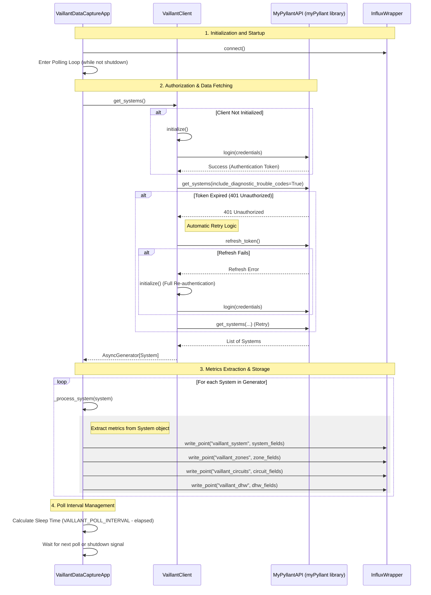

# Vaillant Data Capture Diagrams

This document contains Mermaid diagrams explaining the core logic and flows of the Vaillant Data Capture application.

## Authorization and Polling Flow

The following sequence diagram illustrates how the application initializes, handles authentication (including token refreshes), and performs the periodic polling of Vaillant system data to be stored in InfluxDB.

### Key Components

- **VaillantDataCaptureApp**: The orchestrator. Manages the main loop, state, and coordination between the API client and InfluxDB.
- **VaillantClient**: A wrapper around the `myPyllant` library. It handles the nuances of authentication, token refreshes, and API retries.
- **MyPyllantAPI**: The underlying library used to communicate with the Vaillant (myPyllant) cloud services.
- **InfluxWrapper**: Manages the connection and data writing to the InfluxDB instance.

### Error Handling

The application includes robust error handling for the polling process:
- **401 Unauthorized**: Handled by `VaillantClient`, which attempts a `refresh_token()` first before falling back to a full login.
- **Network/API Errors**: Caught in the main loop, logged, and (if not in dry-run mode) reported as an error metric to InfluxDB.
